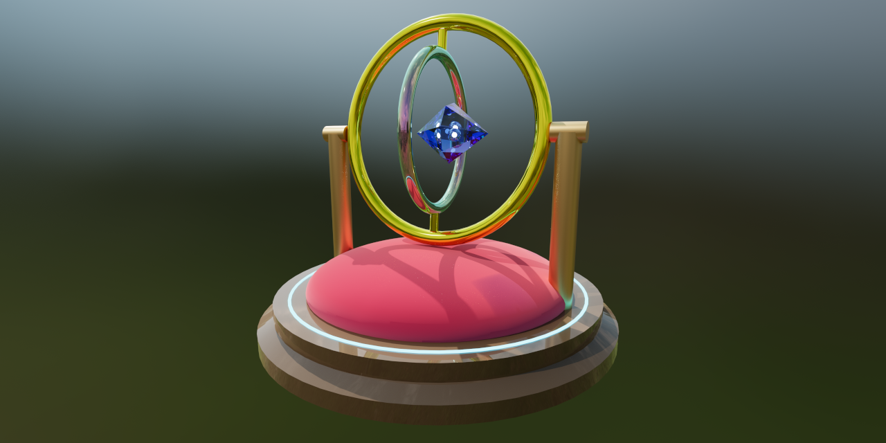

# SCAD GLTF

A powerful WebAssembly (WASM) build of a custom OpenSCAD fork that enables direct compilation of OpenSCAD (`.scad`) scripts to **glTF/GLB** formats natively in JavaScript (Node.js and Browser).

Unlike standard OpenSCAD, this custom engine supports **Physically Based Rendering (PBR)** materials, **Hierarchical Node Animations**, **Skeletal Skinning & Mesh Deformation**, and **Texture Baking**, making it a perfect bridge between procedural CAD generation and modern 3D web rendering engines (like Three.js or Babylon.js).

The C++ source code for this custom OpenSCAD version is included directly in this repository within the `openscad/` subfolder.

**✨ Launch Scadify:** Open the web editor and real-time 3D viewer: [https://iliagrigorevdev.github.io/scad-gltf/](https://iliagrigorevdev.github.io/scad-gltf/)

**🎮 Godot AI Generated Examples:** Play AI-generated Godot examples in your browser: [https://iliagrigorevdev.github.io/scad-godot/](https://iliagrigorevdev.github.io/scad-godot/)



## Features

- **Direct SCAD to GLB conversion:** Compile geometry directly to web-ready binary glTF.
- **Extended PBR Material Support:** Native extensions to the OpenSCAD `color()` module supporting `metalness`, `roughness`, `transmission` (glass), `thickness`, `ior`, `attenuationColor`, `attenuationDistance`, `clearcoat`, `sheen`, `emissive`, `specular`, `iridescence`, `unlit`, `colormap`, and `normalmap`, plus a `$asa` special variable for auto smooth shading.
- **Hierarchical Node Animation & Skeletal Skinning:**
  - **Rigid Parenting:** Define articulated rigid hierarchies, animated cameras, and keyframe animations using `armature()` and `bone()` modules (ideal for robots, mechanical parts, vehicles, and articulated components).
  - **Smooth Skinning / Soft-Body Deformation:** Bind flexible meshes to multiple bones using the `skin()` module with procedural 3D vertex weight functions. Exports standard glTF joints, weights, and inverse bind matrices.
- **Texture Baking:** Automatically generate UVs and bake high-poly details (colors, normals, ORM) onto low-poly meshes using the new `bake()` module.
- **Scene Lighting:** Spawn precise light sources within your hierarchy (point, directional, spot) using the `light()` module, exporting directly to glTF.
- **Web Editor & Real-time Viewer (Scadify):** In-browser IDE with live WebAssembly compilation, GPU path tracing, animation timeline scrubbing, 3MF export for 3D printing, video/image export, URL sharing, `.scad` / `.md` / `.hdr` drag-and-drop, and client-side Godot 4 `.md` project playback.
- **LLM Friendly:** Includes a built-in modular prompt generator (`prompt.js`, `prompt-profiles.js`, and Web UI) with selectable target profiles (OpenSCAD Model, Godot 4, Vite Web 3D, Rust Bevy, Rust wgpu, Unreal Engine 5) to help AI models (like Gemini, Claude, or ChatGPT) generate compatible OpenSCAD scripts and full 3D projects.
- **Local API Server & Editor:** Bundled `scad-gltf serve` CLI utility to manage local `.scad` and `.md` files remotely via REST API with automatic `include`/`use` dependency resolution.
- **CLI Converter:** Bundled `scad-gltf convert` CLI utility for single file and batch compiling `.scad` files with smart dependency hashing.
- **MCP Server for AI Agents:** Bundled `scad-gltf mcp` server enables MCP clients to iteratively design, compile, and **visually inspect** 3D models via multi-angle headless rendering, animation frame evaluation, and browser preview links.
- **AI Studio Extension:** Chrome extension to natively preview, prompt, take chat snapshots, open in Scadify, and locally save AI-generated 3D models directly inside Google AI Studio.
- **Unreal Engine 5, Godot 4, Rust Bevy & Web Integration:** Native Unreal Engine 5 C++ plugin, Godot 4 importer addon, and Rust Bevy compile-time `build.rs` integration.
- **Automated AI Generation:** Pass an OpenAI-compatible base URL (and optional API key) to the `scad-gltf gen` CLI tool to automatically spawn a local MCP server, query the LLM via standard endpoints, allow it to visually iterate with human-in-the-loop feedback, and output a ready-to-run game project or raw 3D asset script.
- **Project Runner, Extractor & Packer:** Bundled `scad-gltf play`, `scad-gltf extract`, and `scad-gltf pack` CLI utilities to safely run generated Markdown projects in isolated temporary environments, extract them to disk, or pack existing directories into single-file Markdown projects.

---

## ✨ Scadify Web Editor

The built-in web editor (**Scadify**) provides a full-featured development environment running entirely in the browser via WebAssembly:

- **Real-Time 3D Viewport:** Instant WebAssembly compilation with auto-rendering, camera auto-framing, wireframe view, grid/axes toggles, ACES Filmic tone mapping, and full-screen mode.
- **Photorealistic GPU Path Tracing:** Built-in hardware-accelerated path tracer with HDR environment lighting for realistic reflections, shadows, and glass refraction. Supports custom `.hdr` environment maps via drag-and-drop.
- **Interactive Animation Controls:** Multi-animation selector, playback controls (play/pause), and smooth timeline scrubbing for animated hierarchies.
- **Modular AI Prompt Generator:** Built-in UI with target **Prompt Profiles** (`OpenSCAD Model`, `Godot 4 Project`, `Vite Web 3D Project`, `Rust Bevy Project`, `Rust wgpu Project`, `Unreal Engine 5 Project`), fine-grained feature toggles (Basic PBR, Auto Smooth, Animations & Skinning, Extended PBR, Texture Baking), per-profile persistent local settings, a **↺ Reset** button for profile defaults, and automatic embedding of engine template files (Godot addon, Rust `build.rs`, UE5 `ScadImporter` plugin).
- **Image & Video Capture:**
  - **📷 PNG Snapshots:** Export high-resolution renders with a single click.
  - **🎥 Video Recording:** Record animation loops directly to MP4/WebM. When Path Tracing is enabled, frames are rendered deterministically for jitter-free, ultra-high-quality animated video captures.
- **Compressed URL Sharing:** Share your designs instantly via URL hash using client-side raw Deflate compression with an optional **Minify Share** toggle to strip comments and whitespace. Integrates with the Web Share API on supported devices.
- **In-Browser Godot Project Playback:** Open, paste, drop, or share single-file `.md` Godot 4 projects (such as outputs from `scad-gltf gen godot` or `scad-gltf pack`) and play them directly inside Scadify. The editor compiles all embedded `.scad` assets to `.glb` via OpenSCAD WASM, injects a runtime `ResourceFormatLoader` autoload, packs everything into an in-memory `.pck`, and executes the project in an isolated Godot WebAssembly runtime (`web_nothreads_release`) with restart/stop controls, console log drawer, PNG screenshot capture, and fullscreen mode.
- **File Management & Drag and Drop:** Load local `.scad` or `.md` files, drop any `.scad` script, Godot `.md` project, or `.hdr` environment map directly onto the viewport, download `.scad` / `.md` source code, or export `.glb` binaries and `.3mf` files (with lazy-union enabled) for 3D printing.
- **Automatic Model Naming:** Extracts model names automatically from `/* Model Name: ... */` header comments for file downloads and exports.
- **Local Workspace Sync:** Connect to `scad-gltf serve` on localhost to load, edit, save, and delete `.scad` files with change detection and recursive dependency resolution (`include` / `use`).
- **PWA Support:** Installable as a Progressive Web App for desktop and mobile.

---

## Installation

This package is designed to be installed directly from GitHub.

**Option 1: Global Installation (Recommended for CLI usage)**
If you plan to use the `scad-gltf` command-line tool and its subcommands anywhere on your system:

```bash
npm install -g scad-gltf
```

**Option 2: Local Installation (For Node.js / Web bundlers)**
If you are importing the package into a JavaScript project:

```bash
npm install scad-gltf
```

---

## Usage (JavaScript / Node.js)

The package provides a convenient `convert.js` wrapper to handle the Emscripten WASM lifecycle, virtual file system, and dependency resolution.

_Note: Because the underlying WASM loader was compiled for the web, it expects the modern `fetch()` API. In Node.js, we provide the path to the `.wasm` file and polyfill `fetch` so it can read local files from disk._

```javascript
import {
  convertScad,
  convertScadToGltf,
  convertScadTo3MF,
  SUPPORTED_EXTENSIONS,
} from "scad-gltf/convert";
import fs from "fs";
import path from "path";
import { fileURLToPath } from "url";

// 1. Locate the WASM file inside node_modules
const wasmPath = path.resolve("node_modules/scad-gltf/ext/openscad.wasm");

// 2. Mock fetch to allow the WASM loader to read local files in Node.js
global.fetch = async (url) => {
  const normalizedPath = url.toString().startsWith("file://")
    ? fileURLToPath(url.toString())
    : url.toString();

  const buffer = fs.readFileSync(normalizedPath);
  return new Response(buffer, {
    status: 200,
    headers: { "Content-Type": "application/wasm" },
  });
};

const scadCode = `
  include <parts/handle.scad>
  color("gold", metalness=1.0, roughness=0.2)
  sphere(r=size);
`;

async function buildModel() {
  try {
    // 3. Compile SCAD to a GLB Uint8Array
    const glbData = await convertScadToGltf(scadCode, {
      wasmUrl: `file://${wasmPath}`,
      binary: true, // true for binary .glb, false for .gltf
      variables: { size: 12 }, // Pass -D key=value parameters
      additionalFiles: {
        // Virtual files for include/use resolution
        "parts/handle.scad": "module handle() { cylinder(h=10, r=2); }",
      },
    });

    // Save to disk (or send to a client, load into Three.js, etc.)
    fs.writeFileSync("output.glb", glbData);
    console.log("Successfully compiled to output.glb!");

    // 4. Or compile directly to 3MF for 3D printing
    const threeMfData = await convertScadTo3MF(scadCode, {
      wasmUrl: `file://${wasmPath}`,
      lazyUnion: true,
    });
    fs.writeFileSync("output.3mf", threeMfData);
    console.log("Successfully compiled to output.3mf!");

    // 5. Or compile to any supported format ("stl", "obj", "svg", "off", "wrl", "csg", "gltf", "glb", "3mf")
    console.log("Supported formats:", [...SUPPORTED_EXTENSIONS]);
    const stlData = await convertScad(scadCode, "stl", {
      wasmUrl: `file://${wasmPath}`,
      variables: { size: 12 },
    });
    fs.writeFileSync("output.stl", stlData);
  } catch (error) {
    console.error("Compilation failed:", error);
  }
}

buildModel();
```

### Compiler Options Reference

| Option            | Type      | Default     | Description                                                                                      |
| :---------------- | :-------- | :---------- | :----------------------------------------------------------------------------------------------- |
| `wasmUrl`         | `string`  | `undefined` | Absolute file URL or HTTP URL pointing to `openscad.wasm`.                                       |
| `binary`          | `boolean` | `true`      | When `true`, outputs binary GLB. When `false`, outputs glTF text/JSON.                           |
| `variables`       | `Object`  | `undefined` | Key-value pairs passed as `-D <key>=<value>` parameters to OpenSCAD.                             |
| `lazyUnion`       | `boolean` | `false`     | Enables OpenSCAD `--enable=lazy-union` optimization.                                             |
| `additionalFiles` | `Object`  | `{}`        | Map of relative virtual file paths to file contents for resolving `include <...>` / `use <...>`. |

### Using in Web Bundlers (Webpack / Vite)

In a browser or Vite project, you do not need to mock `fetch`. Just provide the bundled URL to the `.wasm` file:

```javascript
import wasmUrl from "scad-gltf/openscad.wasm?url";
import { convertScadToGltf } from "scad-gltf/convert";

const scadCode = `cylinder(h=20, r=5);`;

const glbData = await convertScadToGltf(scadCode, { wasmUrl });
```

---

## Command Line Conversion (`scad-gltf convert`)

The package includes a CLI utility to convert `.scad` files to `.glb` and other supported formats (`.glb`, `.gltf`, `.3mf`, `.stl`, `.obj`, `.off`, `.wrl`, `.csg`, `.svg`) directly from your terminal. It supports single files or entire directories, and features smart caching with dependency resolution to speed up build pipelines.

**Usage:**

```bash
scad-gltf convert <input.scad | input_dir> <output_file | output_dir> [options_json] [--cache]
```

**Examples:**

- **Single File:**
  ```bash
  scad-gltf convert model.scad model.glb
  scad-gltf convert model.scad model.stl
  ```
- **Directory Batch Conversion:**
  ```bash
  scad-gltf convert ./src_models ./out_glbs
  # Or override the batch output format via options_json:
  scad-gltf convert ./src_models ./out_stls '{"format": "stl"}'
  ```
- **With Smart Caching (`--cache`):**
  Generates a `.import` file containing a SHA-256 hash of the `.scad` file (including any recursively resolved `include` or `use` files) and compiler options. Subsequent runs skip recompilation if no changes are detected.
  ```bash
  scad-gltf convert ./src_models ./out_glbs --cache
  ```
- **With Options:**
  Pass custom compiler options as a JSON string (or Base64-encoded JSON string):
  ```bash
  scad-gltf convert model.scad model.glb '{"variables": {"size": 20}}'
  ```

---

## Local File Management & Web Editor (`scad-gltf serve`)

`scad-gltf serve` provides a local REST API to manage `.scad` and `.md` files and perform in-memory SCAD-to-GLB conversions. It automatically builds and serves the Scadify Web Editor UI.

It operates strictly on the working directory where the command is executed.

**Start the server:**

```bash
scad-gltf serve [--port <port>]
```

- `--port <port>`: Port to listen on (default: `3000`).

**Available Endpoints:**

- `GET /api/scads`
  - Lists all `.scad` and `.md` files in the current working directory.
- `GET /api/scads/:filename`
  - Retrieves the text content of a specific `.scad` or `.md` file.
- `POST /api/scads`
  - Creates or updates a `.scad` or `.md` file on disk (filenames without `.scad`/`.md` default to `.scad`).
  - **Body:** `{ "filename": "model.scad", "content": "cube(10);" }`
- `DELETE /api/scads/:filename`
  - Deletes a `.scad` or `.md` file.
- `POST /api/convert`
  - In-memory compilation from SCAD string to GLB binary without touching the filesystem.
  - **Body:** `{ "content": "sphere(r=10);", "options": { "variables": { "r": 10 }, "additionalFiles": { "lib.scad": "..." } } }`
  - **Response:** Binary GLB data (`model/gltf-binary`).

---

## 🧩 Google AI Studio Extension

This repository includes a Chrome/Chromium extension located in the [`/editor`](./editor) directory that brings native 3D rendering and visual iteration tools to [Google AI Studio](https://aistudio.google.com/).

When asking an LLM (like Gemini) to generate OpenSCAD code, the extension automatically detects the output and injects interactive controls directly into the chat interface:

- **Instant 3D Preview:** Injects a **"Preview 3D"** button on any OpenSCAD code block to compile and render the model in an embedded 3D viewer with grid, wireframe, and full-screen support.
- **Visual Chat Feedback (📷):** Click the snapshot button inside the 3D preview window to capture a PNG snapshot of the model and **automatically paste it into the AI Studio chat input**, allowing Gemini to visually evaluate and fix geometry.
- **Smart Prompt Injection:** Click the floating **"✨ SCAD"** button to open the configuration modal. Choose a target **Profile** (`OpenSCAD Model`, `Godot 4 Project`, `Vite Web 3D Project`, `Rust Bevy Project`, `Rust wgpu Project`, or `Unreal Engine 5 Project`), customize your feature toggles (PBR, auto-smooth, animations & skinning, baking) with per-profile persistence and **↺ Reset** to defaults, and automatically inject the complete prompt (including bundled engine templates) into your chat input.
- **Local Model Refinement:** Connect to your local `scad-gltf serve` workspace directly from the prompt modal. Select an existing `.scad` file to automatically include its source code as a reference file—either for iterating on standalone OpenSCAD designs or incorporating/extending local models inside generated game/web projects.
- **Open in Scadify:** Click **"Edit"** in the preview window to immediately transfer the current script into the full standalone Scadify editor via compressed URL hash.
- **Local Workspace Saving:** Directly save and overwrite models to your local directory when running `scad-gltf serve`.

### Installation (Chrome / Edge / Brave)

1. **Clone the repository** to your machine:
   ```bash
   git clone https://github.com/iliagrigorevdev/scad-gltf.git
   cd scad-gltf/editor
   ```
2. **Build the extension**:
   ```bash
   npm install
   npm run build
   ```
3. **Load the unpacked extension**:
   - Open your browser and navigate to `chrome://extensions/`
   - Enable **Developer mode** (toggle in the top right corner).
   - Click the **Load unpacked** button.
   - Select the `dist/` folder located inside the `editor/` directory (`scad-gltf/editor/dist`).

### Usage

1. Open [Google AI Studio](https://aistudio.google.com/).
2. Click the floating **"✨ SCAD"** button in the bottom-left corner to choose the features you want the AI to use and paste the prompt into the chat.
3. When the AI returns code, click **"Preview 3D"** above the code block.
4. Use the 📷 button in the preview window to send renders back to the AI for visual debugging or click **"Edit"** to open it in Scadify.

---

## 🤖 Model Context Protocol Server (`scad-gltf mcp`)

This package includes a native [MCP Server](https://modelcontextprotocol.io/) (`scad-gltf mcp`) designed to give AI assistants **visual feedback** during the 3D modeling process.

Instead of generating code blindly, the AI can compile its script, render the 3D scene in a headless browser (Puppeteer + Three.js), and evaluate multi-angle snapshots to iteratively fix geometric or animation errors.

**Exposed MCP Tools:**

- `get_project_prompt`: Generates the specialized system prompt and user input request for creating full procedural 3D projects (`scad`, `bevy`, `wgpu`, `web`, `godot`, `ue`). Accepts an `options` object with all `generatePrompt` feature toggles (`basic`, `transmission`, `clearcoat`, `sheen`, `emissive`, `specular`, `iridescence`, `unlit`, `colormap`, `autoSmoothAngle`, `animation`, `bakeColors`, `bakeNormals`, `bakeOrm`, `bakeUvs`, `lazyUnion`, `lights`) and `scadFiles` (array of `.scad` file paths to embed as context).
- `render_scad_model`: Compiles the generated `.scad` code to GLB and returns base64 PNG renders from requested camera angles (`front`, `back`, `left`, `right`, `top`, `bottom`, `isometric`; defaults to `["front", "top", "isometric"]`) at a given `animation_time` and `animation_index`. Supports a `dependencies` map (`{ [relativePath]: scadCode }`) for `include`/`use` resolution and `return_images: false` for fast text-only syntax validation.
- `generate_scad_preview_link`: Generates a compressed Scadify URL (`https://iliagrigorevdev.github.io/scad-gltf/#c...`) from `scad_code` so the user can interactively inspect the 3D model in a browser.
- `test_godot_project`: Extracts a Markdown Godot 4 project, imports assets headlessly, runs it for `run_time` seconds (default `5.0`), and returns console logs plus a viewport screenshot (unless `return_images: false`). Automatically downloads Godot into `.godot-bin/` if `godot` is not on `PATH`, and uses `xvfb-run` on Linux (install via `sudo apt-get install xvfb`), falling back to headless execution if windowed launch fails.
- `compile_rust_project`: Extracts a Markdown Rust (`bevy` or `wgpu`) project and runs `cargo check` (2-minute timeout), returning compiler logs.
- `compile_ue_project`: Extracts a Markdown Unreal Engine 5 project and compiles it with Unreal Build Tool (4-minute timeout). _(Requires the `UE_ROOT` environment variable)._

### Setup

If you installed the package globally, you can configure your MCP client to use the `scad-gltf mcp` command directly.

**Example `config.json`:**

```json
{
  "mcpServers": {
    "scad-gltf": {
      "command": "scad-gltf",
      "args": ["mcp"]
    }
  }
}
```

---

## Automated AI Generation (`scad-gltf gen`)

By default, the `scad-gltf gen` utility copies a heavily engineered system prompt to your clipboard to paste into an LLM. However, if you provide a **Base URL** (and optional **API Key**), the CLI will fully automate this process. It will automatically spin up the `scad-gltf mcp` server in the background, connect it to your LLM, and allow the AI to _visually evaluate and fix_ its code in real-time before saving the final output file to your disk (`generate_<project_type>_project.md` for projects, or `<model_name>.scad` / `generated_model.scad` for `scad`).

**Supported Generation Types:**

- `scad`: Generate a single raw `.scad` asset file.
- `ue`: Generate a fully packaged Unreal Engine 5 C++ project.
- `godot`: Generate a fully packaged Godot 4 game project containing generated assets and GDScript logic.
- `bevy`: Generate a Rust Bevy game project.
- `wgpu`: Generate a Rust wgpu graphics project.
- `web`: Generate a Vite-based Web3D app (Three.js/Babylon).

**Option 1: Using OpenAI (GPT-4o)**

```bash
export OPENAI_BASE_URL="https://api.openai.com/v1"
export OPENAI_API_KEY="sk-..."
export OPENAI_MODEL="gpt-4o"
scad-gltf gen bevy "A 3D spaceship shooter game"
```

**Option 2: Using Google Gemini (via OpenAI compatibility)**
Because Gemini provides an official OpenAI-compatible endpoint, you can configure it using standard OpenAI variables:

```bash
export OPENAI_API_KEY="AIzaSy..."
export OPENAI_BASE_URL="https://generativelanguage.googleapis.com/v1beta/openai/"
export OPENAI_MODEL="gemini-3.8-flash"
scad-gltf gen godot "A fast-paced 3D hovercraft racing game"
```

**Option 3: Using Local Server**
You can use completely local, uncensored, or fine-tuned vision models by overriding the OpenAI Base URL to point to a local inference server (like `llama.cpp`'s API server).

```bash
export OPENAI_BASE_URL="http://127.0.0.1:8080/v1"
export OPENAI_MODEL="llama-3" # Or whatever model name you've loaded
scad-gltf gen web "A 3D configurator app"
```

**Passing Parameters via JSON**
You can also pass credentials inline as a JSON string argument instead of modifying environment variables:

```bash
scad-gltf gen godot "A futuristic tank game" '{"openaiBaseUrl": "http://127.0.0.1:8080/v1", "openaiModel": "llama-3"}'
```

**Providing Existing SCAD Files (`scadFiles`)**
You can inject your own local `.scad` files into the AI's context using the `scadFiles` JSON option. The AI will embed them into the generated project or use them as a foundation.

```bash
scad-gltf gen godot "A game using the provided player model" '{"scadFiles": ["./player.scad"]}'
```

_Once the automated process completes for full game projects, you can test it instantly using the `play` command:_

```bash
scad-gltf play generate_godot_project.md
```

_Alternatively, to permanently unpack the project to your local filesystem, use the `extract` command:_

```bash
scad-gltf extract generate_godot_project.md
```

---

## Testing Generated Projects (`scad-gltf play`)

The `scad-gltf play` utility is designed to quickly test the single-file Markdown projects produced by the `gen` or `pack` commands. Instead of cluttering your working directory, it unpacks the project into a temporary folder, automatically installs dependencies or builds the project (Unreal Engine 5, Godot, Rust Bevy/wgpu, or Vite), and launches it. Once you close the application, the temporary folder is automatically cleaned up. _(Note: Running UE projects requires the `UE_ROOT` environment variable; Godot projects automatically download Godot if `godot` is not installed on `PATH`)._

**Usage:**

```bash
scad-gltf play <path_to_generated_project.md>
```

---

## Extracting & Packing Projects (`scad-gltf extract` / `scad-gltf pack`)

### Extracting Generated Projects (`scad-gltf extract`)

When you are satisfied with a generated project and want to continue developing it yourself, use the `scad-gltf extract` command to permanently unpack the Markdown file to your disk.

It reads the `### filepath` headers and writes the code blocks to their respective directories.

**Usage:**

```bash
# Extract files into the current working directory
scad-gltf extract <path_to_generated_project.md>

# Extract files into a specific directory
scad-gltf extract <path_to_generated_project.md> ./my_new_game
```

### Packing Existing Directories (`scad-gltf pack`)

Use `scad-gltf pack` to serialize an existing local project directory (such as a Godot, Vite, Rust, or Unreal project) into a single `### filepath` Markdown file for sharing, editing, or playing in Scadify / `scad-gltf play`.

**Usage:**

```bash
scad-gltf pack <input_directory> [output.md] [--no-root]
```

- **`[output.md]`**: Target `.md` file path or destination directory. Defaults to `<input_directory_name>.md` in the current working directory.
- **`--no-root`**: Excludes the input directory's root folder name from `### filepath` headers.
- **Automatic Filtering**: Automatically skips binary files, paths containing whitespace, the output file itself, and common build/cache directories.

---

## Extended OpenSCAD Syntax

This custom fork introduces new syntax not found in standard OpenSCAD.

### 1. PBR Materials, Procedural Colormaps & Smooth Shading

The standard `color()` module has been extended with standard glTF PBR attributes, procedural texture colormaps, and auto smooth normals:

```openscad
// You can set the default auto smooth angle globally
$asa = 30.0;

color(
    "white",
    roughness = 0.0,                    // 0.0 (glossy) to 1.0 (matte)
    metalness = 1.0,                    // 1.0 for metals, blocks light transmission
    transmission = 0.9,                 // 0.0 to 1.0 for glass/water transparency (requires alpha=1.0)
    thickness = 2.0,                    // Volume thickness for refraction
    ior = 1.5,                          // Index of refraction (Water: ~1.33, Glass: ~1.5, Diamond: ~2.4)
    attenuationColor = [1.0, 1.0, 1.0], // Tint of light passing through volume
    attenuationDistance = 0.0,          // Distance light travels before fully tinted
    clearcoat = 1.0,                    // Reflective top clearcoat layer (car paint/varnish)
    clearcoatRoughness = 0.1,
    sheen = 1.0,                        // Microfiber backscattering (cloth/velvet rim light)
    sheenColor = [1.0, 0.5, 0.5],
    sheenRoughness = 0.2,
    emissive = [0.0, 0.0, 0.0],         // Glowing color (RGB vector)
    emissiveIntensity = 1.0,            // Multiplier for emissive glow
    specularColor = [1.0, 1.0, 1.0],    // Tint for specular reflections
    specularIntensity = 1.0,            // Strength of specular reflections
    iridescence = 0.0,                  // Thin-film interference (soap bubbles, oil sheen)
    iridescenceIOR = 1.3,
    unlit = false,                      // Shadeless material unaffected by lighting
    colormap = function(x, y, z) [0.5, 0.5, 0.5, 1.0], // Procedural 3D->RGBA surface texture
    $asa = 45.0                         // Generates smooth vertex normals below this angle threshold.
                                        // Surface shading only; does NOT alter polygon count.
) {
    cylinder(h=10, r=5);
}
```

#### Procedural `colormap` Functions

Because OpenSCAD separates function and variable namespaces, passing a named function directly (e.g. `colormap=my_func`) evaluates to `undef`. Always wrap custom functions in a function literal (lambda):

```openscad
function pattern(x, y, z) = [sin(x * 10) / 2 + 0.5, cos(y * 10) / 2 + 0.5, 0.5, 1.0];

// Automatically UV-unwraps and bakes into a 256x256 base color texture.
// Wrap in bake(resolution=512, index=1) to customize resolution or share a texture atlas.
bake(resolution=512) {
  color("white", colormap=function(x, y, z) pattern(x, y, z))
    cube([10, 10, 10]);
}
```

### 2. Hierarchical Node Animations & Skeletal Skinning

Define armatures, hierarchical bone trees, animated cameras, keyframe animations, and soft-body mesh skinning.

#### A. Rigid Parenting

Meshes placed directly inside a `bone()` module are rigidly attached to that bone's transform:

```openscad
anim_data = [
  ["Swing", [
    // Format: ["BoneName", [ [time_in_sec, [rot_x, y, z], [trans_x, y, z]], ... ]]
    ["Pendulum", [
      [0.0, [0, 0, 0],   [0, 0, 10]],
      [1.0, [0, 45, 0],  [0, 0, 10]],
      [2.0, [0, -45, 0], [0, 0, 10]],
      [3.0, [0, 0, 0],   [0, 0, 10]]
    ]]
  ]]
];

armature(animations = anim_data) {
    bone(name="Pendulum", t=[0, 0, 10], r=[0, 0, 0]) {
        color("silver", metalness=0.9, roughness=0.1)
        cylinder(h=10, r=1, center=false);
    }
}
```

**Keyframe & Camera Rules:**

- **Rotation Subdivision**: Because glTF uses quaternion shortest-path interpolation, never rotate more than 90 degrees between consecutive keyframes. Split full 360-degree rotations into 90-degree steps (e.g., `0`, `90`, `180`, `270`, `360`).
- **Absolute Local Keyframes**: Keyframe translations and rotations are absolute in local space and completely replace the bone's resting `t` and `r` attributes during playback (if translation is omitted, it defaults to the resting `t`).
- **Animated Cameras**: Naming a bone `"Camera"` or `"camera"` exports an animated glTF camera looking forward along `+Y` with `+Z` as up. You can append suffixes such as `"Camera1"`, `"Camera_fov60"` (Perspective 60° FOV), or `"Camera_ortho_mag10"` (Orthographic scale 10). Physical part names like `"CameraMount"` are ignored.

#### B. Skeletal Skinning (Smooth Mesh Deformation)

To bind a soft mesh to multiple bones, wrap geometry in the `skin()` module directly inside `armature()`. Pass an array of bone names and a 3-argument weight function `function(x, y, z)` computing bone weights from localized vertex positions. Weights are automatically normalized and capped to the 4 strongest influences per vertex:

```openscad
anim_data = [
  ["Bend", [
    ["TopBone", [
      [0.0, [0, 0, 0]],
      [1.0, [0, 45, 0]],
      [2.0, [0, 0, 0]]
    ]]
  ]]
];

armature(animations = anim_data) {
  // Skinned Soft Mesh (Must be placed directly in armature, outside bone hierarchy)
  // Blends smoothly from BottomBone (Z=0) to TopBone (Z=10)
  skin(bones=["BottomBone", "TopBone"], weights=function(x, y, z) [1.0 - (z / 10), z / 10]) {
    color([0.2, 0.6, 1.0]) cylinder(h=10, r=2, $fn=32);
  }

  // Bone Hierarchy
  bone(name="BottomBone", t=[0, 0, 0], r=[0, 0, 0]) {
    color("gray") cube([8, 8, 2], center=true); // Rigid base

    bone(name="TopBone", t=[0, 0, 10], r=[0, 0, 0]) {
      // Child bones inherit parent transforms
    }
  }
}
```

### 3. Texture Baking

Project details from a high-resolution mesh onto a low-resolution mesh using the `bake()` module. This auto-generates UVs and can output solid colors, tangent-space normals, and ORM (Occlusion/Roughness/Metallic) textures.

```openscad
// Two-child syntax: projects Child 1 (High Poly) onto Child 2 (Low Poly)
bake(
    colors = true,       // Project and bake base color
    normals = true,      // Bake tangent-space normal map
    orm = false,         // Bake Occlusion/Roughness/Metallic map
    resolution = 1024,   // Output texture resolution
    distance = 2.0,      // Max raycast distance
    bias = 1e-4,         // Raycast origin offset
    dilation = 2,        // Pixel padding around UV islands
    msaa = 2,            // Anti-aliasing level (supersampling)
    index = 0,           // Atlas group index (meshes sharing an index > 0 share the same atlas)
    rotate_uvs = true    // Allow UV island rotation for optimal packing
) {
    color("white") sphere(r=10, $fn=100);                         // Child 1: High Poly Source
    color("white", roughness=0.5, $asa=45) sphere(r=10, $fn=20);  // Child 2: Low Poly Target
}

// Single-child syntax: Generate UV coordinates & tangents (or configure colormap resolution/atlas)
bake(resolution=512, index=1) {
    color("gold", metalness=1.0) cube([10, 10, 10]);
}
```

### 4. Scene Lighting

Add glTF lights (`"directional"`, `"point"`, `"spot"`) directly into your model hierarchy. Directional and spot lights shine along `-Z` by default—use `translate()` and `rotate()` around `light()` to orient them.

Directional lights use **Lux** (e.g., `300–500` indoors, `100000` sun), while point and spot lights use **Candelas** with inverse-square distance attenuation (typically `1000.0` to `10000.0+`):

```openscad
// A spot light pointing down at an angle (high candela intensity for physically based attenuation)
translate([0, 0, 50]) rotate([0, 30, 0])
  light(type="spot", color=[1, 0.8, 0.8], intensity=5000.0, range=0.0, innerConeAngle=15.0, outerConeAngle=30.0)
    color("gray") cylinder(h=2, r=1, center=true); // A visual representation of the light fixture
```

---

## AI Integration (`prompt.js`)

Because LLMs (like Gemini or Claude) only know standard OpenSCAD syntax up to their training cutoff, `scad-gltf/prompt` provides helpers to generate both raw OpenSCAD syntax prompts (`generatePrompt`) and full target-engine project prompts (`buildProfilePrompt`, `PROMPT_PROFILES`, `getPromptProfile`, `getEditorPromptProfiles`). These inject the rules for PBR, animations, skinning, baking, and engine-specific conventions directly into your prompt context.

**Usage:**

```javascript
import { generatePrompt, buildProfilePrompt } from "scad-gltf/prompt";

const description =
  "a futuristic robot arm with flexible rubber joints and glowing metallic plating, animated to bend";
const promptContext = generatePrompt(description, {
  basic: true, // Metalness and roughness
  transmission: true, // Glass, transmission, ior, thickness
  clearcoat: true, // Clearcoat layers
  sheen: true, // Fabric sheen
  emissive: true, // Glow parameters
  specular: true, // Specular overrides
  iridescence: true, // Thin-film interference
  unlit: true, // Shadeless unlit material rules
  colormap: false, // Procedural colormap() & bake() atlas rules
  autoSmoothAngle: true, // $asa rules
  animation: true, // Armature, bone & skinning syntax
  lights: false, // Light rules
  bakeColors: false, // Texture baking flags
  bakeNormals: false,
  bakeOrm: false,
  bakeUvs: false,
  lazyUnion: false, // Document --enable=lazy-union behavior
  modelName: true, // Include /* Model Name: ... */ output instruction
});

// You can now pass this context string directly to an AI API
// or print it to the console to paste into Gemini.
console.log(promptContext);

// Or build a complete system + user prompt for a specific target profile
// ("scad", "godot", "web", "bevy", "wgpu", or "ue"):
const projectPrompt = buildProfilePrompt("godot", {
  task: "A third-person 3D robot platformer with animated collectibles",
  promptOptions: { animation: true, emissive: true },
});

console.log(projectPrompt);
```

### Workflow

Once connected, an AI assistant can use the server to execute the following loop:

1. **Retrieve Syntax Rules:** The assistant calls the `get_project_prompt` tool to get the extended syntax rules and project structure guidelines.
2. **Generate Code:** The assistant writes the `.scad` script based on your design request.
3. **Compile & Visually Inspect:** The assistant calls the `render_scad_model` tool to inspect rendered multi-angle frames and keyframes, fixing any errors before final export.

---

## Environment Variables

| Variable          | Description                                                                                                                          |
| :---------------- | :----------------------------------------------------------------------------------------------------------------------------------- |
| `OPENAI_BASE_URL` | Base URL of an OpenAI-compatible `/chat/completions` endpoint for `scad-gltf gen`.                                                   |
| `OPENAI_API_KEY`  | Optional Bearer API key for `scad-gltf gen`.                                                                                         |
| `OPENAI_MODEL`    | Model name sent in `scad-gltf gen` requests.                                                                                         |
| `VERBOSE`         | When set, prints the full AI reasoning/thinking logs during `scad-gltf gen`.                                                         |
| `UE_ROOT`         | Path to your Unreal Engine installation folder (required for `compile_ue_project` and `scad-gltf play` on Unreal Engine 5 projects). |

---

## Development

### Building for WebAssembly

If you modify the C++ code inside the `openscad/` directory, you will need to recompile the WebAssembly engine. The OpenSCAD subtree provides a convenient Docker wrapper to handle the Emscripten toolchain automatically. Ensure you have Docker installed and running.

1. **Navigate to the `openscad` directory:**
   ```bash
   cd openscad
   ```
2. **Configure the build using the Docker script:**
   ```bash
   ./scripts/wasm-base-docker-run.sh emcmake cmake -B build-web -DCMAKE_BUILD_TYPE=Release -DEXPERIMENTAL=1
   ```
3. **Compile the WASM binaries:**
   ```bash
   ./scripts/wasm-base-docker-run.sh cmake --build build-web -j2
   ```
4. **Copy the compiled artifacts back to the JavaScript extension:**
   ```bash
   cp build-web/openscad.js ../ext/
   cp build-web/openscad.wasm ../ext/
   ```

### Updating the OpenSCAD Subtree

This repository includes a custom fork of OpenSCAD in the `openscad/` subfolder using Git Subtree. If you need to pull upstream updates from the official OpenSCAD repository and merge them with our custom modifications, follow these steps:

1. **Ensure your working tree is clean:**
   ```bash
   git status
   ```
2. **Make sure the upstream remote is added** (you can check with `git remote -v`). If not, add it:
   ```bash
   git remote add openscad https://github.com/openscad/openscad.git
   ```
3. **Pull and merge the upstream changes:**
   ```bash
   git subtree pull --prefix=openscad openscad master --squash
   ```
   _(Note: `--squash` is highly recommended as it prevents the main repository's history from being flooded with thousands of upstream OpenSCAD commits)._
4. **Resolve any merge conflicts:**
   Because we have modified the C++ engine locally within the subfolder, conflicts are expected. Open the conflicting files, resolve the markers, and complete the merge:
   ```bash
   git add .
   git commit
   ```

### Godot Web Runtime & Headless Setup

Playing `.md` Godot projects in Scadify uses Godot's single-threaded Web export libraries (`godot.js` and `godot.wasm` from `web_nothreads_release.zip` for Godot) placed in `editor/public/godot/`. These are installed automatically by `predev` / `prebuild` when running `npm run dev` or `npm run build` in `editor/`, or manually via:

```bash
cd editor
npm run setup:godot
```

For CLI and MCP tools (`scad-gltf play` and `test_godot_project`), if `godot` is not on your `PATH`, `scad-gltf` automatically downloads the Godot binary into `.godot-bin/`. On headless Linux, `test_godot_project` requires `xvfb`:

```bash
sudo apt-get install xvfb
```

---

## Architecture & Credits

- **Core Engine:** Built on a custom fork of [OpenSCAD](https://openscad.org/) (source included in the `openscad/` directory).
- **glTF Export:** Export mechanics utilize the [tinygltf](https://github.com/syoyo/tinygltf) library.
- **Godot Web Runtime:** In-browser `.md` project playback uses the [Godot Engine](https://godotengine.org/).
- **UV Unwrapping:** Texture baking utilizes the [xatlas](https://github.com/jpcy/xatlas) library for automatic UV parameterization.
- **Path Tracing:** The web editor utilizes [three-gpu-pathtracer](https://github.com/gkjohnson/three-gpu-pathtracer) for high-quality rendering.
- **Environment Map (HDR)**: [Aristea Wreck Puresky](https://polyhaven.com/a/aristea_wreck_puresky) by **Jarod Guest** via [Poly Haven](https://polyhaven.com/). Licensed under [CC0](https://polyhaven.com/license).
- **License:** See the `LICENSE` file (GPL-2.0 or later, inheriting from standard OpenSCAD).
